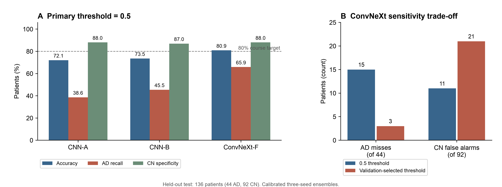
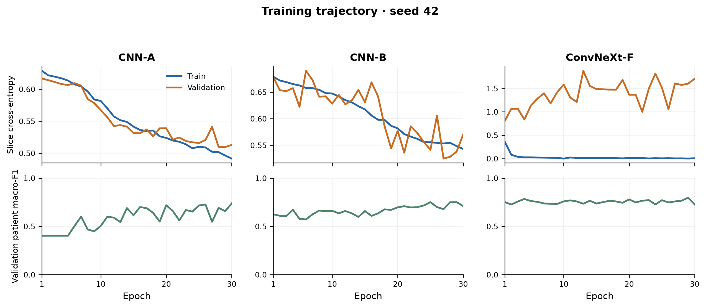

# ADNI MRI classification: ConvNeXt and CNN baselines

**COMP3710 individual pattern-recognition project · Yuqing Jiang · s4982104**

## Executive summary

This project tests whether a ConvNeXt-Tiny classifier offers a useful advantage over a simple convolutional neural network (CNN) for classifying Alzheimer's disease (AD) and cognitively normal (CN) patients from ADNI MRI slices. The operational question is whether model confidence can support a review queue without leaving dangerous confident errors unattended. We implemented two CNN baselines and a fully fine-tuned ConvNeXt, evaluated them on the same patient-disjoint test cohort, and measured accuracy, class-specific errors, confidence, referral coverage, and inference cost. The three-seed ConvNeXt ensemble reached **80.88% patient-level test accuracy** (110/136), meeting the course target. Its AD recall was **65.91%** (29/44), leaving 15 AD patients misclassified at the primary threshold. A validation-selected sensitivity threshold reduced test AD misses to 3/44 but raised CN false alarms from 11/92 to 21/92. The model is useful as a research comparison and as a candidate for human-reviewed triage; the measured error profile does not support autonomous clinical decisions.



*Figure 1. Left: patient-level test accuracy, AD recall, and CN specificity at the fixed 0.5 threshold for calibrated three-seed ensembles (136 patients: 44 AD, 92 CN). Right: ConvNeXt-F AD misses and CN false alarms at 0.5 and at the supplemental threshold selected on validation patients. Counts are patients, not slices. Source: frozen final evaluation, job 708475.*

## Problem, model, and working principle

The course task is binary AD/CN classification using the ADNI data on Rangpur. The supplied source folders overlap by 216 patients, so using them directly as train and test would leak patient information. We generated a new patient-level split and kept all 20 selected MRI slices for each patient in one partition. The dataset folder calls the normal class `NC`; this report uses the course term `CN`. Labels are CN=0 and AD=1 after mapping the source JSON's AD=2 value.

The simple CNN learns spatial patterns directly from grayscale slices. CNN-A uses ordinary cross-entropy; CNN-B uses a class-weighted loss. ConvNeXt-F uses a locally implemented PyTorch ConvNeXt-Tiny backbone adapted from [Liu et al. (2022)](https://arxiv.org/abs/2201.03545) and the [TorchVision reference implementation](https://github.com/pytorch/vision/blob/main/torchvision/models/convnext.py), initialized with ImageNet-1K weights and fully fine-tuned. The [TorchVision weight preset](https://docs.pytorch.org/vision/stable/models/generated/torchvision.models.convnext_tiny.html) determines its three-channel normalization and 236-pixel resize followed by a 224-pixel center crop. Model components are in `modules.py`; loading and preprocessing are in `dataset.py`; training and checkpointing are in `train.py`; inference examples are in `predict.py`. Adaptation and licensing are documented in [THIRD_PARTY_NOTICES.md](THIRD_PARTY_NOTICES.md).

For a patient, each model predicts an AD probability for each of 20 slices. We average those 20 probabilities, then average the three seed-specific patient probabilities within a model family. A positive temperature fitted on validation patients calibrates each ensemble's patient probabilities, following [Guo et al. (2017)](https://proceedings.mlr.press/v70/guo17a.html). A score at or above 0.5 predicts AD. The supplemental sensitivity threshold and the 10% review-queue rule were fixed using validation data before the final test evaluation.

## Feasibility review and tutor check-off

The one-page written feasibility review was used at the compulsory consultation on **23 October 2026**. Its four required parts are included below. The tutor asked about project progress and gave no specific requested changes. This section records the proposal and preliminary evidence as they stood at the midpoint; the completed experiment and revised resource findings appear later in this report.

### User need, scope, and acceptance criteria

I proposed an AD/CN research prototype for neuroimaging reviewers, examining confident errors against patient-review workload. Patient scores would average 20 slice AD probabilities, with a score of at least 0.5 predicting AD. The acceptance criteria were: (1) no patient overlap among train, validation, and test; (2) at least 80% patient-level test accuracy; (3) a same-patient comparison of the advanced model and CNN baseline using accuracy, balanced accuracy, per-class precision and recall, macro-F1, and AUROC; (4) validation-selected referral rules with patient-review proportion, retained errors, and retained AD false negatives; and (5) an initial target of 8 GPU-hours and at most 20 GB peak VRAM, with any budget change documented.

### Model choice and course concepts

The course ADNI images are two-dimensional grayscale JPEG slices. A CNN trained from scratch was the baseline; ConvNeXt-Tiny was the Hard-difficulty model, using ImageNet-1K initialization and a two-class head. Convolution learns spatial features, while supervised classification maps them to AD/CN labels. Patient-level splitting prevents cross-patient leakage and validation-based selection limits test-set tuning. Because the pipelines differ in capacity, initialization, and preprocessing, an observed performance difference cannot be assigned solely to architecture. The CNN input was planned as grayscale `1×240×256`, scaled to `[0,1]`; the ConvNeXt preprocessing was to be fixed before profiling.

### Preliminary feasibility evidence

The original train/test folders shared 216 patients. A fixed seed-42 selection retained 680 patients (221 AD, 459 CN), one scan and 20 slices each. A stratified 60/20/20 split assigned 408/136/136 patients with no overlap. An A100 40 GB CUDA probe passed. Four training/validation image reads and 26 local tests supported the early data pipeline; these checks preceded full training and resource measurement.

### Risks, budget, and fallback

Class imbalance and a small AD cohort could make accuracy misleading. The plan therefore included class metrics, fixed validation roles, patient-level probability aggregation, and a sealed test set. The initial allocation was 8 GPU-hours: 1 for debugging, 2 for CNN, 3 for ConvNeXt, and 2 for repeats/evaluation. Jobs were planned to remain below two hours, with short debugging jobs and checkpoints. If memory exceeded 20 GB, batch size would be reduced; if runtime exceeded the estimate, tuning would be narrowed while preserving one complete baseline comparison. Human referral was treated as a request for review, not as an assumed correction. The next planned experiment at the review stage was the C0c DataLoader batch check, followed by a CNN training and prediction smoke test measuring peak memory and step time.

## Data and leakage control

The read-only source audit found 30,520 JPEG slices, 1,526 scan IDs, and 680 patients. A deterministic seed-42 rule selected one qualified scan per patient; each selected scan contributed 20 slices, giving 13,600 slices. AD and CN patients were stratified into train, validation, and test: **408/136/136 patients** and **8,160/2,720/2,720 slices**. The test group comprises 44 AD and 92 CN patients. Patient, scan, and image-path intersections among partitions were zero. Original source-folder names are retained only as provenance; model loading uses the new split column. Scan selection and split audits are implemented in `select_scans.py` and `split_patients.py`.

Training fits model weights; validation selects checkpoints, temperatures, sensitivity thresholds, and the referral policy; the test partition was opened once after those rules were frozen. All reported classification and uncertainty metrics use patients as the unit of analysis. Slice-level outputs are retained to make patient aggregation auditable.

## Experimental protocol

All three families used the same patient split and seeds 42, 43, and 44. The nine checkpoints were selected by validation patient-level negative log-likelihood (NLL), then verified by stored hashes. The final test protocol fixed the nine weights, patient aggregation, equal seed weights, validation-fitted temperatures, 0.5 primary threshold, supplemental thresholds, and referral rule before inference. Final inference used FP32, batch size 4, and TF32 disabled on an NVIDIA A100-PCIE-40GB. The frozen run processed 24,480 test slices across nine models and produced one patient score per model and 136-patient ensemble decisions. Its recorded job ID is 708475.

For patient-sampling uncertainty, 2,000 AD/CN-stratified bootstrap resamples used one shared index set (seed 42) for intervals and paired model differences. These intervals condition on the trained models and chosen protocol. The standard deviation across three training seeds measures a separate source of variation.



*Figure 2. Top: slice-level unweighted cross-entropy; bottom: validation patient-level macro-F1 over the 30-epoch seed-42 runs for CNN-A, CNN-B, and fully fine-tuned ConvNeXt-F. The two loss curves share an axis within each model panel; loss panels have separate vertical scales. ConvNeXt training loss approaches zero while validation loss rises, indicating overfitting in this run, although its patient macro-F1 remains around 0.75. Checkpoints were selected by validation patient-level NLL, not by the final training epoch. Source: frozen R3 epoch logs; aggregate plot data and plotting code are in `figures/`.*

## Held-out test results

The primary operating point is the validation-frozen threshold of 0.5. Probabilistic metrics below use calibrated ensemble scores. `TP/FN/TN/FP` treats AD as positive.

| Three-seed ensemble | Accuracy (95% patient CI) | AD recall | CN specificity | Macro-F1 | AUROC | NLL | Brier | TP/FN/TN/FP |
|---|---:|---:|---:|---:|---:|---:|---:|---|
| CNN-A | 72.06% (65.44–78.68) | 38.64% | 88.04% | 0.641 | 0.820 | 0.487 | 0.162 | 17/27/81/11 |
| CNN-B | 73.53% (66.91–80.15) | 45.45% | 86.96% | 0.671 | 0.797 | 0.507 | 0.170 | 20/24/80/12 |
| ConvNeXt-F | **80.88% (74.26–86.76)** | **65.91%** | 88.04% | **0.776** | **0.895** | **0.387** | **0.121** | 29/15/81/11 |

| Ensemble | AD precision | AD recall | CN precision | CN recall | Balanced accuracy |
|---|---:|---:|---:|---:|---:|
| CNN-A | 60.71% | 38.64% | 75.00% | 88.04% | 63.34% |
| CNN-B | 62.50% | 45.45% | 76.92% | 86.96% | 66.20% |
| ConvNeXt-F | 72.50% | 65.91% | 84.38% | 88.04% | 76.98% |

ConvNeXt-F exceeded CNN-A accuracy by **8.82 percentage points** (paired 95% interval 1.47–16.18) and CNN-B by **7.35 points** (0.74–13.99) on these fixed patients and models. Its three individual seed models averaged 79.90% accuracy with a sample standard deviation of 2.58 percentage points. The calibrated ensemble's ten-bin confidence expected calibration error (ECE) was 0.045. Calibration did not improve every test probabilistic metric: ConvNeXt NLL rose from 0.383 before temperature scaling to 0.387 after it, and Brier score rose from 0.120 to 0.121. This is evidence that a validation-fitted temperature does not guarantee test-set improvement.

### Sensitivity threshold and referral

The supplemental threshold was selected on validation to attain at least 80% AD recall there. It is a separate operating point, not a correction to the primary result.

| Ensemble | Supplemental threshold | Test AD recall | AD misses | CN false alarms | Test accuracy |
|---|---:|---:|---:|---:|---:|
| CNN-A | 0.288932 | 77.27% | 10/44 | 24/92 | 75.00% |
| CNN-B | 0.333587 | 75.00% | 11/44 | 21/92 | 76.47% |
| ConvNeXt-F | 0.303211 | **93.18%** | **3/44** | 21/92 | 82.35% |

The main 10% referral policy ranks patients by the *raw* ensemble probability's distance from 0.5, using patient ID to break ties, and refers `ceil(0.10 × 136) = 14` patients. It was evaluated alongside the primary 0.5 decision, without claiming that a reviewer would correct an error.

| Ensemble | Referred | Errors among referred | AD misses among referred | Errors remaining among 122 automatic cases | AD misses remaining |
|---|---:|---:|---:|---:|---:|
| CNN-A | 14 | 10/38 | 5/27 | 28 | 22 |
| CNN-B | 14 | 9/36 | 7/24 | 27 | 17 |
| ConvNeXt-F | 14 | 6/26 | 3/15 | 20 | **12** |

For ConvNeXt-F, a 14-patient review queue captured 6 of 26 errors and 3 of 15 AD misses. Most missed AD patients therefore remained outside that queue. The 5% and 20% queue sizes are available in the frozen evaluation outputs for follow-up capacity analysis.

### Computational cost

The R4 benchmark timed **one model at a time** on validation data, on the same A100, with FP32, TF32 disabled, batch size 4, native model preprocessing, and a warm filesystem cache. End-to-end time includes JPEG decoding, preprocessing, transfer, forward pass, and patient aggregation. It excludes model loading, integrity checks, scoring, and output writes. Each value is the median of three seed-specific run medians. Peak VRAM is allocated CUDA memory during the single-model pass; it is not whole-process GPU use or a measured three-model ensemble cost.

| Model | Parameters | End-to-end milliseconds per slice | Peak allocated VRAM (MiB) |
|---|---:|---:|---:|
| CNN-A | 23,426 | 0.557 | 64.0 |
| CNN-B | 23,426 | 0.560 | 64.0 |
| ConvNeXt-F | 27,821,666 | 3.055 | 187.2 |

ConvNeXt-F's measured single-model slice latency is about 5.5 times CNN-A's under this protocol. Its higher test accuracy and AD recall therefore carry a compute cost. These values should not be read as real-time clinical request latency.

## Failure-case autopsy

We inspected nine anonymous 20-slice contact sheets: three confident AD misses, three confident CN false alarms, and three uncertain but correct cases. Four representative errors appear below. The observations describe visible image variation; they do not identify a causal mechanism for a model prediction. Images and the private case-to-source index remain outside Git.

| Anonymous case | Truth → prediction | Calibrated P(AD) | In 10% review queue? | Observed in the 20-slice sheet |
|---|---|---:|---|---|
| AD miss 01 | AD → CN | 0.013 | No | Tiles 5–7 and 17 appear darker than 1–4 and 9–14; internal dark-region shape differs in tiles 15–16. |
| AD miss 02 | AD → CN | 0.242 | No | Outer contours are similar in tiles 1–10; internal dark-region shape changes across 11–16 and the cross-section changes again in 17–20. |
| CN false alarm 01 | CN → AD | 0.888 | No | The right outer region is darker in tiles 3–6, especially tile 6; tiles 11–19 are brighter with clearer internal texture. |
| CN false alarm 02 | CN → AD | 0.764 | No | Upper contours look flatter in tiles 1–5; contour and internal dark-region appearance differ in 6–13; tiles 14–15 are darker than 16–20. |

All four examples were confidently wrong and escaped the uncertainty-based queue. The three uncertain but correct cases were referred, consuming review capacity without correcting an error. No reviewed contact-sheet tile was wholly blank; visible brightness and contour differences alone did not establish motion artifacts, acquisition defects, or a clinical explanation. The case review thus pinpoints a referral failure mode: distance from 0.5 does not detect all important errors.

## Recommendation and limitations

**Recommendation to the project manager:** advance ConvNeXt-F as the stronger research prototype, but retain specialist review for any clinical-facing use. At the primary threshold it improves accuracy and AD recall over both CNN baselines on the held-out cohort, at roughly 5.5 times CNN-A's measured single-model slice latency. If the aim is AD sensitivity, the preselected lower threshold yields 41/44 AD detections while raising CN false alarms to 21/92. A fixed 10% uncertainty queue alone leaves 12 AD misses in automatic handling; it is insufficient as the only safety control. A future study should test referral rules that target confident errors, measure reviewer outcomes, and validate on independent sites before deployment decisions.

This experiment uses one seeded scan per patient and 44 AD test patients. It does not estimate longitudinal or external-site generalization. The bootstrap intervals reflect patient sampling conditional on fixed models, calibration, and class counts. The case sheets support description of appearance, not a diagnosis or a causal image explanation. Training and test predictions are reproducible from the frozen source and checkpoint hashes; the course data and weights must be obtained through authorized access and are not distributed in this repository.

## Reproduction and repository contents

The five required files are `modules.py` (CNN and ConvNeXt components), `dataset.py` (loading, patient-safe split entry point, and optional train-only intensity augmentation), `train.py` (CNN training, formal ConvNeXt training entry point, test-inference entry point, checkpoint saving, and epoch-curve plotting), `predict.py` (saved-weight CNN or ConvNeXt test-case inference and aggregate confusion visualisation), and this `README.md`. The original experiment runners remain in `run_r3_convnext.py` and `run_r6_final.py`. The latter loads nine saved CNN/ConvNeXt checkpoints, predicts the test cases, and writes slice predictions, patient predictions, aggregate metrics, and a verification summary. The optional brightness augmentation defaults to off and was **not** used for the reported experiment. Additional scripts implement manifest creation, audits, calibration, referral analysis, and resource profiling.

The recorded Rangpur environment for the final evaluation was Python 3.11.13, PyTorch 2.14.0+cu130, TorchVision 0.29.0, NumPy 2.4.6, Pillow 12.3.0, Matplotlib 3.11.2, CUDA 13.0, and an NVIDIA A100-PCIE-40GB. Exact Python dependency pins are in [requirements.txt](requirements.txt). On a supported host, create an environment and run the synthetic and regression tests:

```bash
python3.11 -m venv .venv
.venv/bin/python -m pip install -r requirements.txt
.venv/bin/python -m unittest discover -s tests -q
```

For the course-facing entry points, run `.venv/bin/python train.py --formal-convnext --help` to see the formal training inputs, `.venv/bin/python train.py --plot-history --history /path/to/epochs.jsonl --plot-output /path/to/learning_curves.png` to plot recorded losses and validation macro-F1, and `.venv/bin/python predict.py --test-mode --help` for saved-weight test inference. `train.py --test-mode` exposes that same test-inference path. The frozen nine-model final evaluation is driven by `run_r6_final.py` and `run_r6_final.slurm`; the [R6 run guide](R6_FINAL_RUN_GUIDE.md) explains its source, checkpoint, and evidence checks. Dataset manifests, patient-level predictions, raw MRI, and model weights are excluded from Git.

**Frozen result provenance:** The reported 80.88% result was generated with source commit `0967d26e4c23dbfbd513c496f69aae540f57af0b`, before the three course-facing entry points were expanded. The unchanged `r5_final_protocol.json` contains hashes of that version. To reproduce the exact reported run, check out that commit and use the same authorized ADNI data, split manifests, and nine hash-verified checkpoints. The new entry points are demonstrations and were not used to generate or tune the reported test result. The saved evidence records hashes for inputs, checkpoints, code, and output tables.

For a standalone **test-set** example using one saved ConvNeXt checkpoint and the private split manifest, run:

```bash
.venv/bin/python predict.py --test-mode \
  --manifest /path/to/split_samples.csv \
  --summary /path/to/split_summary.json \
  --checkpoint /path/to/best_patient_nll.pt \
  --model convnext_tiny \
  --output-dir /path/to/new_test_example_output \
  --device cuda
```

This writes slice/patient prediction CSVs, `test_prediction_summary.json`, and an aggregate `confusion_matrix.png`. It demonstrates one checkpoint and does not replace the calibrated three-seed ensemble result. The frozen nine-model final test command is:

```bash
.venv/bin/python run_r6_final.py \
  --data-root /path/to/authorized_private_r5_tree \
  --output-dir /path/to/new_final_test_output
```

Its output includes `evaluation.json`, `metrics.csv`, and nine model-specific `slice_predictions.csv` files; the aggregate patient results are in `patient_tables/`. For a concrete anonymized **ConvNeXt-F ensemble** output example from the frozen test, `confident_AD_miss_01` had ground truth AD (`label=1`), calibrated `P(AD)=0.012636`, primary predicted class CN (`prediction=0`), and `refer_10_percent=0`. Thus a confident false negative was not sent to the 10% review queue. The alias and numbers are copied from the private case index; patient and scan identifiers are omitted. Individual patient tables, MRI images, and weights stay outside Git.

## Artificial Intelligence Usage Disclosure

OpenAI ChatGPT/Codex assisted experiment planning, Python code and test drafting, debugging, numerical cross-checks, figure and documentation preparation, and English editing. The assistance is logged in the local project progress record. I inspected the code and source data, ran the experiments, checked AI-assisted outputs against saved evidence, and approved the final interpretation. AI did not generate MRI labels, select test-set thresholds, or alter the final test predictions. Verification included unit and regression tests, input/output hashes, independent recomputation of patient predictions and bootstrap results, and manual review of nine case contact sheets.

## References

1. Liu, Z., et al. (2022). *A ConvNet for the 2020s*. CVPR. https://arxiv.org/abs/2201.03545
2. TorchVision. `convnext_tiny` model and `IMAGENET1K_V1` weights documentation, version 0.29.0. https://docs.pytorch.org/vision/stable/models/generated/torchvision.models.convnext_tiny.html
3. Guo, C., Pleiss, G., Sun, Y., & Weinberger, K. Q. (2017). *On Calibration of Modern Neural Networks*. ICML, PMLR 70, 1321–1330. https://proceedings.mlr.press/v70/guo17a.html
4. COMP3710/COMP7710 teaching team. *Pattern Recognition Working Prototype Project*, final assessment specification, version 2.5 (DRAFT), 2026.
